<p align="center">
  
</p>

<p align="center">
  <a href="https://github.com/ishandutta2007/Awesome-Awesome-Awesome"></a><a href="https://discord.gg/jc4xtF58Ve"></a>
  <a href="https://github.com/ishandutta2007/Awesome-Multi-Agent-System-Builders/stargazers"></a>
  <a href="https://github.com/ishandutta2007/Awesome-Multi-Agent-System-Builders/network/members"></a>
  <a href="https://github.com/ishandutta2007/Awesome-Multi-Agent-System-Builders/issues"></a>
  <a href="https://github.com/ishandutta2007/Awesome-Multi-Agent-System-Builders/blob/main/LICENSE"></a>
  <a href="https://github.com/ishandutta2007"></a>
</p>

---

# 🤖 Awesome Multi-Agent System Builders

> **A curated directory of SaaS platforms, visual drag-and-drop orchestration canvases, declarative configuration layers, and open-source runtimes for building autonomous multi-agent systems without vendor lock-in.**

[](https://github.com/ishandutta2007/Awesome-Multi-Agent-System-Builders/pulls)
[](https://github.com/ishandutta2007/Awesome-Multi-Agent-System-Builders/graphs/commit-activity)
[](https://github.com/ishandutta2007/Awesome-Multi-Agent-System-Builders)

---

## 📑 Table of Contents

- [🎯 Overview & Architecture](#-overview--architecture)
- [🌐 Sector Overview & Market Dynamics](#-sector-overview--market-dynamics)
- [☁️ SaaS & Hosted Platforms](#️-saas--hosted-platforms)
- [💻 Open-Source GitHub Projects](#-open-source-github-projects)
- [🛡️ Key Tradeoffs: Managed vs. Open Source](#️-key-tradeoffs-managed-vs-open-source)
- [🤝 How to Contribute](#-how-to-contribute)
- [💖 Support & Sponsoring](#-support--sponsoring)
- [⭐ Star History](#-star-history)
- [📜 License & Disclaimer](#-license--disclaimer)

---

## 🎯 Overview & Architecture

Modern AI agent engineering has shifted from single-prompt chatbots to **collaborative multi-agent systems** where specialized agents cooperate, critique, delegate, and execute multi-step workflows.

This repository tracks tools that provide:
- 🎨 **Visual & Low-Code Canvas Interfaces** — Drag-and-drop builders to design agent loops, human-in-the-loop checkpoints, and routing DAGs.
- 📜 **Declarative Agent Configurations** — Define swarms, prompt templates, tools, and guardrails via YAML/JSON without hardcoding logic.
- 🚀 **Cross-Cloud Deployment Runtimes** — Run agents on any infrastructure (AWS, GCP, Azure, or Kubernetes) while preserving governance, audit trails, and RBAC.

```
      +--------------------------------------------------------------+
      |               Multi-Agent Orchestrator / Router              |
      +---------------+--------------+---------------+---------------+
                      |              |               |
        +-------------v--+    +------v-------+  +----v-----------+
        | Planning Agent |    | Coding Agent |  | Research Agent |
        +-------------+--+    +------+-------+  +----+-----------+
                      |              |               |
      +---------------+--------------+---------------+---------------+
      |             Shared Memory & Tool Bus (MCP Servers)           |
      +--------------------------------------------------------------+
```

---

## 🌐 Sector Overview & Market Dynamics

The global **Autonomous AI Agents and Multi-Agent Systems market** was estimated at **$5.1 Billion in 2024** and is projected to skyrocket to over **$45.8 Billion by 2030**, exhibiting an extraordinary Compound Annual Growth Rate (**CAGR of ~44.2%**). 

The sector is currently **moderately fragmented**:
- 🏢 **Enterprise Suites (Concentrated Core)**: Mega-cap tech giants (Microsoft, Alphabet, Amazon, Salesforce, ServiceNow) leverage proprietary enterprise data and CRM lock-in to capture native corporate workflows.
- 🚀 **Open Source & Independent Builders (Fragmented Frontier)**: Rapid innovation in visual orchestration studios, modular MCP tool registries, and portable agent runtimes (Dify, MetaGPT, AutoGen, CrewAI, LangGraph) is preventing a single "winner-take-all" outcome, allowing engineering teams to deploy multi-agent architectures independently across hybrid clouds.

---

## ☁️ SaaS & Hosted Platforms

The following hosted platforms provide fully managed multi-agent building, execution environments, and native cloud integrations. They are sorted in **descending order by company valuation / market capitalization**.

| 🏢 Platform | 💰 Company Size (Valuation / Revenue) | 🏷️ Specific Starting Price | 🎁 Free Tier & Trial Limits | 🌟 Best For & Key Capabilities |
| :--- | :--- | :--- | :--- | :--- |
| [**Microsoft Copilot Studio**](https://copilotstudio.microsoft.com/) | **~$3.12 Trillion** Market Cap<br>*(FY24 Revenue: ~$245B)* | **$200/tenant/month** *(includes 25,000 messages/mo; add-on packs $100 per 25k messages)* or $30/user/mo via M365 Copilot | **30-day free trial** with full studio features, custom agent creation, and 10,000 test messages | **Microsoft-centric enterprises** needing seamless M365, Teams, SharePoint, and Power Platform data integration with enterprise identity and compliance. |
| [**Google Vertex AI Agent Builder**](https://cloud.google.com/products/agent-builder) | **~$2.18 Trillion** Market Cap<br>*(FY24 Revenue: ~$307B)* | **$12.00 per 1,000 search queries**; **$0.0005 per 1,000 characters** (~$0.075 per 1M input tokens with Gemini 1.5 Flash) for conversational agent turns | **90-day free trial with $300 credits** for all new GCP accounts; includes **1,000 free search queries/month forever** on standard search | **GCP-native teams** looking for multimodal reasoning, Agent Development Kit (ADK) integration, and enterprise search grounding on Google Gemini. |
| [**Amazon Bedrock Agents**](https://aws.amazon.com/bedrock/agents/) | **~$1.95 Trillion** Market Cap<br>*(FY24 Revenue: ~$575B)* | **$0.00015 / 1k input tokens** & **$0.0002 / 1k output tokens** (Titan Text Express) or **$0.00025 / $0.00125** (Claude 3 Haiku) + $0.20/1M AWS Lambda invocations | **12 months free tier** on underlying compute (1M Lambda requests/mo + 5GB S3 forever) plus **$100 to $1,000 POC credits** via AWS Activate | **AWS-native developers** wanting managed multi-step planning, automated API schema execution, and knowledge base vector RAG. |
| [**Salesforce Agentforce**](https://www.salesforce.com/agentforce/) | **~$285 Billion** Market Cap<br>*(FY24 Revenue: ~$34.9B)* | **$2.00 per conversation / agent interaction**; Enterprise Edition agent add-on seats start at **$125/user/month** | **30-day free trial** via Salesforce Developer Edition org with unlimited sandbox testing credits and standard CRM connectors | **Salesforce CRM users** deploying autonomous agents directly inside Sales Cloud, Service Cloud, and Data Cloud without external API duct tape. |
| [**Coze (ByteDance)**](https://www.coze.com/) | **~$225 Billion** Valuation<br>*(FY24 Revenue: ~$120B)* | **$9.90/month** (Pro tier with 1,000 monthly credits and priority LLM execution) | **Free forever plan** with 100 free queries/day, standard visual workflow canvas, and multi-bot collaboration | **Rapid visual prototyping** across Discord, Telegram, Slack, and web widgets with an extensive pre-built plugin ecosystem. |
| [**ServiceNow Now Assist**](https://www.servicenow.com/products/now-assist.html) | **~$185 Billion** Market Cap<br>*(FY24 Revenue: ~$10B)* | **$100/user/month** (Pro Plus / Enterprise Plus SKU tier) or **$2,000/month** for a 5,000 Assist Units consumption pack | **30-day free trial** via ServiceNow Personal Developer Instance (PDI) with Now Assist plugins pre-activated at zero cost | **ITSM & HR automation** requiring multi-agent orchestration embedded directly into IT service catalogs and corporate ticketing lifecycles. |
| [**Relevance AI**](https://relevanceai.com/) | **~$200 Million** Valuation<br>*(Raised: $23M)* | **$199/month** (Team plan with 10,000 credits/mo and multi-agent workflows) | **Free forever plan** with 100 credits/day (3,000 credits/month) and up to 3 active autonomous agents | **B2B business operations**, marketing automation, and sales development teams deploying collaborative swarms via no-code UI. |
| [**Dust**](https://dust.tt/) | **~$150 Million** Valuation<br>*(Raised: $21M)* | **$29/user/month** (Pro plan with custom agent builders, team spaces, and integrations) | **15-day free trial** with unlimited agent test runs, Notion/Slack connectors, and up to 10 user seats | **Modern startups and tech teams** requiring data-grounded custom assistants with rigorous privacy boundaries and internal knowledge sync. |

---

## 💻 Open-Source GitHub Projects

Explore the leading open-source multi-agent frameworks, visual canvases, and portable orchestrators. Repositories are sorted in **descending order by GitHub star count**.

### 1. [Significant-Gravitas/AutoGPT](https://github.com/Significant-Gravitas/AutoGPT) [](https://github.com/Significant-Gravitas/AutoGPT/stargazers)
- 🌟 **The flagship vision for autonomous multi-agent systems and agent builders**
- Features a visual builder interface (**AutoGPT Builder**) that allows users to connect blocks, agent logic, and external APIs on an interactive canvas.
- Modular component library, graph execution engine, and native Docker deployment.
- **Best for:** Builders seeking a battle-tested agent platform with an active ecosystem and visual workflow builder.

### 2. [langgenius/dify](https://github.com/langgenius/dify) [](https://github.com/langgenius/dify/stargazers)
- 🌟 **The premier open-source visual multi-agent workflow and LLM application development platform**
- Intuitive drag-and-drop prompt orchestration, multi-agent chat flows, RAG pipelines, and tool orchestration.
- Enterprise-ready with self-hosting support, role-based access control, monitoring, and comprehensive REST APIs.
- **Best for:** Engineering teams and product managers who want to design, test, and ship production-grade multi-agent applications visually.

### 3. [FoundationAgents/MetaGPT](https://github.com/FoundationAgents/MetaGPT) [](https://github.com/FoundationAgents/MetaGPT/stargazers)
- 🌟 **Multi-agent framework simulating structured software development companies**
- Assigns defined SOPs (Standard Operating Procedures) to specialized agents: Product Managers, Architects, Project Managers, and Engineers.
- Takes a one-line requirement and coordinates multi-agent consensus to generate PRDs, system architectures, APIs, and complete code repositories.
- **Best for:** Complex collaborative problem-solving and software engineering automation using structured role-playing agents.

### 4. [microsoft/autogen](https://github.com/microsoft/autogen) [](https://github.com/microsoft/autogen/stargazers)
- 🌟 **Microsoft's open-source multi-agent conversation and orchestration framework**
- Enables multiple LLM agents to converse, solve complex problems, execute code, and integrate human feedback in real time.
- Features AutoGen Studio for visual prototyping, graph-based routing, and asynchronous event-driven architecture.
- **Best for:** Researchers and developers building stateful, conversational agent swarms with custom communication topologies.

### 5. [crewAIInc/crewAI](https://github.com/crewAIInc/crewAI) [](https://github.com/crewAIInc/crewAI/stargazers)
- 🌟 **Lean, production-ready framework for orchestrating autonomous role-playing AI agents**
- Define agents with specific roles, backstories, goals, and delegated tool sets; orchestrates execution sequentially or hierarchically.
- Seamless integration with LangChain tools, local Ollama models, and enterprise LLM APIs.
- **Best for:** Teams building task-driven, collaborative agent crews with deterministic delegation and minimal boilerplate.

### 6. [FlowiseAI/Flowise](https://github.com/FlowiseAI/Flowise) [](https://github.com/FlowiseAI/Flowise/stargazers)
- 🌟 **Open-source drag-and-drop UI canvas for building LLM apps and multi-agent workflows**
- Built on LangChain and LangGraph; visual nodes for conversational agents, supervisor agents, memory buffers, and tool integrations.
- Instant API endpoints, embeddable web chat widgets, and self-hosted Docker deployment.
- **Best for:** Rapid prototyping and deploying visual multi-agent workflows without writing frontend or backend glue code.

### 7. [langchain-ai/langgraph](https://github.com/langchain-ai/langgraph) [](https://github.com/langchain-ai/langgraph/stargazers)
- 🌟 **Graph-based orchestration library for building stateful, multi-actor LLM applications**
- Expresses agent loops, branching logic, cyclical execution, and human-in-the-loop approvals as resilient computational graphs.
- First-class persistence, time-travel debugging, and fault-tolerant state management across complex agent networks.
- **Best for:** Enterprise developers requiring deterministic control, state persistence, and complex cyclical graphs for multi-agent systems.

### 8. [OpenBMB/ChatDev](https://github.com/OpenBMB/ChatDev) [](https://github.com/OpenBMB/ChatDev/stargazers)
- 🌟 **Virtual software company driven by communicative multi-agent collaboration**
- Operates through simulated organizational phases: Designing, Coding, Testing, and Documenting with specialized agent roles.
- ChatDev Visualizer allows real-time inspection of inter-agent dialogues, code revisions, and decision chains.
- **Best for:** Exploring multi-agent communication dynamics, automated code generation, and team simulation.

### 9. [agiresearch/AIOS](https://github.com/agiresearch/AIOS) [](https://github.com/agiresearch/AIOS/stargazers)
- 🌟 **LLM Agent Operating System & SDK (Cerebrum)**
- NAACL 2025 paper-backed architecture providing an OS runtime layer for scheduling, resource allocation, and concurrent execution of multiple LLM agents.
- Four-layer modular architecture (LLM kernel, memory manager, storage system, tool coordinator) with community Agent Hub.
- **Best for:** Systems researchers and developers optimizing concurrent agent scheduling and resource allocation.

### 10. [docker/cagent](https://github.com/docker/docker-agent) [](https://github.com/docker/docker-agent/stargazers)
- 🌟 **The declarative YAML-based multi-agent builder from Docker**
- Zero orchestration code: define teams of specialized agents in declarative `cagent.yaml` files and run them anywhere Docker runs.
- Native support for Model Context Protocol (MCP) tools, pluggable RAG (BM25 + embeddings), and OCI registry packaging.
- **Best for:** Docker-native platform engineers wanting multi-agent systems that ship, version, and scale just like containers.

### 11. [cortezaproject/corteza](https://github.com/cortezaproject/corteza) [](https://github.com/cortezaproject/corteza/stargazers)
- 🌟 **100% open-source low-code platform with the @Human multi-agent automation layer**
- Trusted by government institutions and Fortune 100 enterprises as an Apache 2.0 alternative to Salesforce.
- The @Human layer adds safe building, deployment, and governance of multi-agent infrastructures and external integrations.
- **Best for:** Organizations migrating from Salesforce seeking an enterprise low-code platform with integrated multi-agent automation.

### 12. [jrosseruk/AgentBreeder](https://github.com/jrosseruk/AgentBreeder) [](https://github.com/jrosseruk/AgentBreeder/stargazers)
- 🌟 **Framework-agnostic deploy-and-govern layer for multi-agent systems**
- *"AgentBreeder is to agents what Docker + Kubernetes is to microservices"* — wrap agents from LangGraph, CrewAI, AutoGen, or custom SDKs into `agent.yaml`.
- 6 multi-agent orchestration strategies (router, sequential, parallel, hierarchical, supervisor, fan-out) with unified RBAC and cost tracking.
- **Best for:** Platform engineers who want enterprise governance and multi-cloud portability without rewriting existing agent code.

### 13. [dqsjqian/agent-guild](https://github.com/dqsjqian/agent-guild) [](https://github.com/dqsjqian/agent-guild/stargazers)
- 🌟 **Project bootstrapper that configures full multi-agent IDE development environments**
- Installs agents, skills, persistent memory banks, and MCP servers for Claude Code, Cursor, and Codex with a single command.
- Includes code-navigation MCP servers (`codenav-mcp`, `webnav-ts-mcp`) and spec-driven development (`sdd`) rules.
- **Best for:** Development teams needing a standardized, out-of-the-box multi-agent coding setup across modern AI code editors.

### 14. [kunle12/lurawi](https://github.com/kunle12/lurawi) [](https://github.com/kunle12/lurawi/stargazers)
- 🌟 **NoCode/LowCode visual canvas for agent-based automation workflows**
- Drag-and-drop workflow designer compiling visual graphs into XML/JSON deployment artifacts for the Lurawi Docker runtime engine.
- Modular custom function classes, REST API endpoints, and cloud deployment ready.
- **Best for:** Developers looking for a lightweight visual canvas that compiles into standalone executable runtimes.

### 15. Specialized Python Frameworks & Multi-Tenant Runtimes

- 🐍 **[GenXAI](https://pypi.org/project/genxai-framework/)**: Graph-first Python orchestration framework with `genxai` CLI, built-in governance (RBAC, PII filters, audit logging), consensus flow patterns (`RoundRobinFlow`, `SelectorFlow`, `P2PFlow`), and a visual Studio on its roadmap.
- 🏢 **[Harnis](https://pypi.org/project/harnis/)**: Multi-tenant agent runtime engine enforcing strict tenant token isolation, OIDC console sign-in (PKCE), per-tenant provider whitelists, and hard `max_cost_usd_per_turn` ceilings.

---

## 🛡️ Key Tradeoffs: Managed vs. Open Source

| Dimension | ☁️ Managed SaaS (Copilot Studio, Agentforce, Bedrock) | 💻 Open Source (Dify, AutoGen, CrewAI, LangGraph) |
| :--- | :--- | :--- |
| **Vendor Lock-in** | 🔴 High — proprietary agent SDKs and cloud runtimes | 🟢 Zero — run on any cloud, bare metal, or local hardware |
| **Setup Time** | 🟢 Minutes — managed authentication, storage, and UI | 🟡 Moderate — requires hosting, DB setup, and key management |
| **Data Privacy & Governance** | 🟡 Bound to vendor DPA, compliance tiers, and cloud regions | 🟢 Full control — self-host in air-gapped or VPC environments |
| **Cost Predictability** | 🔴 Usage surges can lead to unexpected monthly bills | 🟢 Pay only for base compute and direct LLM token costs |
| **Customizability** | 🟡 Limited to pre-approved connectors and UI components | 🟢 Complete source code access to modify orchestration logic |

---

## 🤝 How to Contribute

Contributions are warmly encouraged! To submit a new multi-agent builder or platform:

1. 🍴 **Fork the Repository** on GitHub.
2. 🌿 **Create a Feature Branch**: `git checkout -b feature/add-new-builder`.
3. 📝 **Add Your Entry**:
   - For SaaS: Add to the table with exact company valuation, starting price, and free tier limits.
   - For Open Source: Add with description, stargazers badge (`style=social&color=white`), and target use case. Sort by star count!
4. 🚀 **Submit a Pull Request** with a brief summary explaining the product's orchestration capabilities.

Please verify all links before submitting! Check out the central [Awesome-Awesome-Awesome](https://github.com/ishandutta2007/Awesome-Awesome-Awesome) hub for more curated lists.

---

## 💖 Support & Sponsoring

If you found this curated ecosystem directory helpful, consider supporting the maintenance and continuous discovery of new multi-agent builders:

- ⭐ **Star this repository** to help others discover it!
- 🍴 **Fork it** to customize your personal agent stack!
- 📢 **Share it** on LinkedIn, X/Twitter, and Discord communities!
- ☕ **Sponsor the Maintainer**: Support ongoing development and open-source curation via the [GitHub Sponsors Dashboard](https://github.com/sponsors/ishandutta2007).

<p align="center">
  <a href="https://github.com/sponsors/ishandutta2007">
    
  </a>
</p>

---

## ⭐ Star History

[](https://star-history.dera.page/#ishandutta2007/Awesome-Multi-Agent-System-Builders&type=date&legend=top-left)

---

## 📜 License & Disclaimer

- Distributed under the **MIT License**. See [`LICENSE`](file:///C:/Users/hp/Documents/Projects/Awesome-Multi-Agent-System-Builders/LICENSE) for more information.
- *Disclaimer: This repository is community-curated for informational and architectural evaluation purposes. Brand names, logos, and trademarks belong to their respective companies.*

---

<p align="center">
  <b>Built with ❤️ by the open-source AI community. Keep agents open, portable, and governable!</b>
</p>
